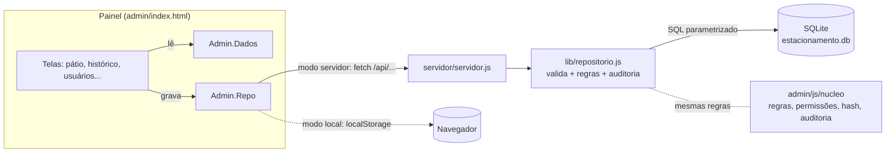
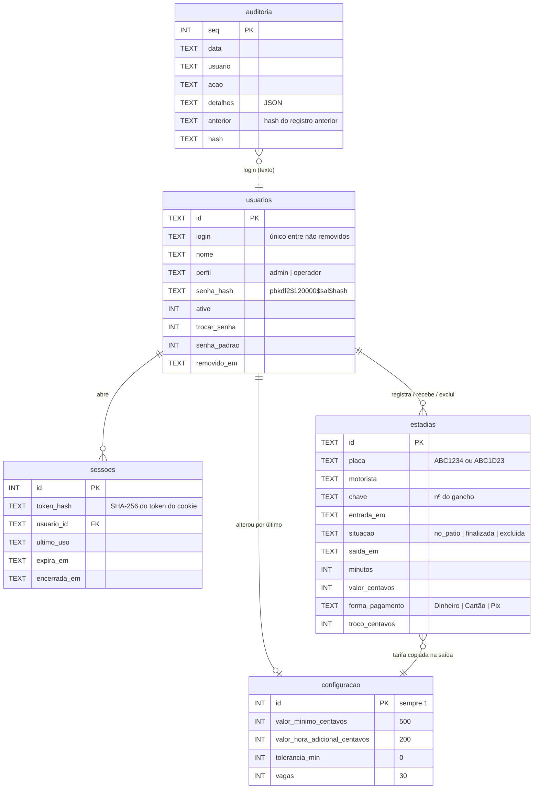

# Banco de dados do módulo de estacionamento

O painel administrativo agora pode gravar tudo num **banco de dados SQL** em vez do navegador: pátio, histórico de saídas, usuários, configurações e auditoria. Assim, todos os computadores e celulares conectados veem o mesmo pátio, e os dados não se perdem quando alguém limpa o navegador.

| | |
| --- | --- |
| Banco | **SQLite 3**: um único arquivo, já embutido no Node.js. Não precisa instalar servidor de banco. |
| Arquivo | `servidor/dados/estacionamento.db` (fica fora do Git) |
| Esquema | [`servidor/banco/001-esquema-inicial.sql`](../servidor/banco/001-esquema-inicial.sql) |
| Quem acessa o banco | só o servidor: [`servidor/lib/repositorio.js`](../servidor/lib/repositorio.js) |
| API | [`servidor/servidor.js`](../servidor/servidor.js) |
| Testes | `npm run test:banco` (96 testes) e `npm run test:e2e-servidor` (33 testes no navegador) |
| Roteiro manual | [ROTEIRO-DE-TESTES.md](ROTEIRO-DE-TESTES.md) |

---

## 1. Como ligar

Precisa do **Node.js 22 LTS (22.13 ou mais novo) ou 24 LTS**: [nodejs.org](https://nodejs.org). Nenhum pacote extra é necessário.

```bash
npm run servidor
```

O terminal mostra os endereços:

```
  Painel do estacionamento - servidor ligado
  Banco de dados: ...\servidor\dados\estacionamento.db
  Neste computador:  http://localhost:8080/admin/
  Na rede (celular): http://192.168.0.15:8080/admin/
  Primeiro acesso: usuário admin / senha admin (troque logo após entrar).
```

- Na primeira vez o banco é criado sozinho, com o usuário **admin / admin**.
- No menu lateral do painel aparece o selo **"Dados no banco de dados (servidor)"**. Se aparecer "Dados só neste navegador", a página não foi aberta pelo servidor.
- Para desligar o servidor: `Ctrl + C`.

### Já usava o painel sem servidor? Leve os dados para o banco

1. No painel antigo, que guardava os dados no navegador: **Configurações → Backup → Baixar backup**.
2. Com o servidor **desligado** e antes de ligá-lo pela primeira vez, rode:
   ```bash
   npm run banco:importar -- "C:\Users\voce\Downloads\backup-chaveiro-senador-2026-10-26.json"
   ```
3. Ligue o servidor e entre com o **mesmo usuário e senha** de antes.

A importação confere a auditoria do arquivo. Se ela tiver sido adulterada, nada é importado. Se estiver íntegra, a cadeia continua no banco com os mesmos números e hashes.

### Configurações do servidor (opcionais)

| Variável | Padrão | Para quê |
| --- | --- | --- |
| `PORTA` | `8080` | porta HTTP |
| `HOST` | `0.0.0.0` | `0.0.0.0` aceita celulares e PCs da rede; `127.0.0.1` aceita só este PC |
| `BANCO` | `servidor/dados/estacionamento.db` | arquivo do banco |
| `COPIAS` | `servidor/dados/copias` | pasta das cópias automáticas |
| `COOKIE_SEGURO` | — | `1` quando o acesso for por HTTPS |
| `CONFIAR_PROXY` | — | `1` atrás de nginx/Caddy: usa o IP e o protocolo do proxy |

---

## 2. Como as peças conversam



- **Dois modos, escolhidos sozinhos.** Ao abrir, o painel pergunta `GET /api/saude`. Se o servidor responder, ele usa o **modo servidor**, com os dados no banco. Senão, usa o **modo local**, com os dados no navegador, como antes. Abrir o arquivo direto, o GitHub Pages e a demonstração continuam funcionando.
- **As telas não mudaram de lógica.** Elas leem pelos atalhos de `Admin.Dados` e gravam por `Admin.Repo`, que existe nas duas versões: `repositorio-local.js` e `repositorio-servidor.js`.
- **O servidor decide.** No modo servidor, o valor da saída é **recalculado no servidor** com a tabela de preços do banco, as permissões são conferidas lá e cada ação é auditada lá. O navegador não consegue forjar um registro.
- **Código compartilhado.** O cálculo do valor (RN01), a validação da placa (RN02), as permissões, o hash de senha (PBKDF2) e a cadeia da auditoria vêm dos **mesmos arquivos** do painel (`admin/js/nucleo/`). Navegador e servidor nunca discordam.
- **Vários aparelhos.** A cada 15 segundos o painel pergunta `GET /api/versao`, que devolve o número do último registro de auditoria. Se mudou, alguém gravou algo, e ele recarrega e redesenha.

---

## 3. Tabelas

Convenções: datas em texto ISO 8601 UTC (`2026-10-26T21:30:00.000Z`) e dinheiro em **centavos** (`INTEGER`; R$ 5,00 = `500`). Nada é apagado de verdade: lançamentos excluídos ficam marcados e usuários removidos ganham `removido_em`.



| Tabela | O que guarda |
| --- | --- |
| `usuarios` | Quem acessa o painel. A senha é só o hash PBKDF2. O hash do módulo antigo (`legado$sal$hash`) é aceito e trocado por PBKDF2 no primeiro login. |
| `sessoes` | Logins. O token fica **só no cookie**; o banco guarda o SHA-256 dele. Registra IP, navegador e o motivo do encerramento. |
| `bloqueios_login` | Erros seguidos e bloqueio progressivo (5, depois 15, depois 60 min) por login, inclusive de logins que não existem. |
| `configuracao` | Tabela de preços e vagas. Tem uma linha só. |
| `estadias` | Cada carro que entrou. O **pátio** e o **histórico** estão na mesma tabela, separados por `situacao`. Na saída, a tarifa usada é copiada para a linha (`tarifa_*`), então mudar o preço não altera saídas antigas. |
| `auditoria` | Registro **somente-inclusão** e encadeado por hash, no mesmo cálculo do painel. |
| `auditoria_ancora` | Hash de partida da cadeia, quando ela veio de um backup que já tinha descartado registros antigos. |
| `auditoria_importada` | Auditorias de backups restaurados com o banco em uso. Ficam como referência, sem misturar com a cadeia oficial. |
| `schema_migracoes` | Quais arquivos de migração já foram aplicados. |

### Regras que o próprio banco garante

Mesmo que alguém pule o servidor, o banco recusa:

| Regra | Como |
| --- | --- |
| Placa fora do padrão | `CHECK (placa GLOB '[A-Z][A-Z][A-Z][0-9][A-Z0-9][0-9][0-9]')` |
| Mesma placa duas vezes no pátio | índice único parcial `WHERE situacao = 'no_patio'` |
| Saída paga sem valor, minutos ou forma de pagamento | `CHECK` por situação |
| Saída antes da entrada; valor recebido menor que o total | `CHECK` |
| Forma de pagamento desconhecida | `CHECK (forma_pagamento IN ('Dinheiro','Cartão','Pix'))` |
| Mudar valor, horário ou placa de uma saída já paga | gatilho `tg_estadias_protege_pagamento` (só pode ser **excluída**) |
| "Desexcluir" um lançamento | gatilho `tg_estadias_excluida_definitiva` |
| Editar ou apagar a auditoria | gatilhos `tg_auditoria_sem_alteracao` e `tg_auditoria_sem_exclusao` |
| Preço negativo, tolerância acima de 59, vagas fora de 1 a 999 | `CHECK` na configuração |

### Visões (relatórios prontos)

| Visão | Mostra |
| --- | --- |
| `vw_patio` | Carros no pátio, com minutos e **valor atual calculado pelo SQL** (RN01: mínimo + adicional × ⌈(min − 60 − tolerância) / 60⌉). Os testes garantem que dá o mesmo valor do painel. |
| `vw_historico` | Saídas pagas, sem as excluídas. |
| `vw_faturamento_diario` | Saídas, total e permanência média por dia e forma de pagamento. |
| `vw_clientes` | Por placa: visitas, último nome, modelo e total gasto. O painel usa essa visão para reconhecer cliente antigo na entrada. |

Exemplos de perguntas feitas direto ao banco, como faturamento do mês, clientes frequentes, exclusões e logins com erro, estão em [`servidor/consultas-uteis.sql`](../servidor/consultas-uteis.sql).

---

## 4. API

Todas as respostas são JSON. A sessão vai num cookie `HttpOnly`. As rotas que alteram dados exigem o cabeçalho `X-Painel: 1`.

| Método e rota | Permissão | O que faz |
| --- | --- | --- |
| `GET /api/saude` | pública | Diz que o servidor e o banco estão no ar |
| `POST /api/sessao` | pública | Login `{login, senha}` |
| `GET /api/sessao` · `DELETE /api/sessao` | logado | Sessão atual · Sair |
| `POST /api/sessao/renovar` | logado | Marca uso (prazo de inatividade) |
| `GET /api/estado` | logado | Tudo que as telas precisam, **filtrado pelo perfil** |
| `GET /api/versao` | logado | Número da última ação (sincronização) |
| `POST /api/patio` | `patio.entrada` | Entrada `{nome, placa, entrada, modelo, chave}` |
| `POST /api/patio/:id/saida` | `patio.saida` | Saída `{saida, pagamento, valorRecebido}` (o valor é calculado no servidor) |
| `DELETE /api/patio/:id` | `patio.excluir` | Exclui lançamento feito por engano |
| `DELETE /api/historico/:id` | `historico.excluir` | Tira uma saída do faturamento |
| `PUT /api/config/precos` · `PUT /api/config/vagas` | `config.alterar` | Tabela de preços · Vagas |
| `POST /api/usuarios` | `usuarios.gerenciar` | Cria usuário |
| `PUT /api/usuarios/:id/ativo` · `/senha` · `DELETE /api/usuarios/:id` | `usuarios.gerenciar` | Ativa ou desativa · Redefine a senha · Remove |
| `PUT /api/minha-senha` | `senha.propria` | Troca a própria senha |
| `POST /api/auditoria/eventos` | logado | Só `EXPORTACAO` e `ACESSO_NEGADO` (registrados pelo painel) |
| `POST /api/auditoria/verificar` | `auditoria.ver` | Confere a cadeia inteira do banco |
| `GET /api/backup` · `POST /api/backup/restaurar` | `config.backup` | Backup no formato do painel · Restauração |

O **operador** recebe em `/api/estado` só o próprio usuário, nenhuma auditoria e o histórico de ontem e hoje.

---

## 5. Segurança

- **Senhas:** hash PBKDF2-SHA256 com 120.000 iterações, sal aleatório e comparação em tempo constante. O servidor nunca devolve o hash.
- **Sessão:** token aleatório de 256 bits num cookie `HttpOnly` (o JavaScript não lê) com `SameSite=Strict` (outro site não usa) e `Path=/api`. Expira após 30 min sem uso ou 8 h no total. Desativar um usuário ou trocar a senha derruba as sessões abertas dele.
- **CSRF:** as alterações exigem `X-Painel: 1` e origem igual ao servidor.
- **Força bruta:** bloqueio progressivo por login, mais um limite de 30 tentativas por IP a cada 10 minutos.
- **Injeção de SQL:** todas as consultas usam parâmetros (`?`). Nenhum texto digitado é concatenado em SQL.
- **Arquivos:** o servidor entrega só `admin/`, `assets/`, `imagens/` e as páginas da raiz. O banco, o código do servidor, `.git` e os testes respondem 404.
- **Auditoria:** gravada na mesma transação da ação (ou as duas acontecem, ou nenhuma) e protegida por gatilhos. Mesmo que alguém com acesso ao arquivo desligue os gatilhos e edite um registro, a verificação da cadeia aponta qual foi alterado.
- **HTTPS:** em rede local o tráfego é HTTP. Para acesso pela internet, coloque o servidor atrás de HTTPS (Caddy ou nginx com certificado) e use `COOKIE_SEGURO=1 CONFIAR_PROXY=1`.

Detalhes completos em [SEGURANCA.md](SEGURANCA.md).

---

## 6. Cópias de segurança

| Como | Quando |
| --- | --- |
| **Automática:** `servidor/dados/copias/estacionamento-AAAA-MM-DD-HH-MM-SS.db` | Ao ligar o servidor e a cada 24 h. Mantém as 30 mais recentes. |
| **Na hora:** `npm run banco:copia` | Antes de qualquer mudança importante |
| **Pelo painel:** Configurações → Baixar backup (`.json`) | Para guardar fora do computador e restaurar em qualquer modo |

As cópias usam `VACUUM INTO`, que gera um arquivo consistente mesmo com o servidor ligado. **Guarde cópias fora do computador** (pen drive, nuvem): se o disco falhar, o banco e as cópias automáticas vão junto.

Para **restaurar uma cópia `.db`:** desligue o servidor, troque `servidor/dados/estacionamento.db` pela cópia e ligue de novo.

---

## 7. Futuro

- **Hospedagem:** o mesmo servidor roda num VPS ou num serviço com Node.js. Basta apontar o domínio e colocar HTTPS na frente.
- **Outro banco (PostgreSQL/MySQL):** o acesso ao banco está concentrado em `servidor/lib/repositorio.js` e usa SQL comum. Para migrar, é preciso traduzir o esquema (tipos, gatilhos e `julianday` nas visões) e trocar o driver em `banco.js`. As telas e a API não mudam.
- **Mudanças no esquema:** crie `servidor/banco/002-descricao.sql`. O servidor aplica sozinho, uma vez, na próxima vez que ligar. Nunca edite um arquivo de migração que já rodou.
